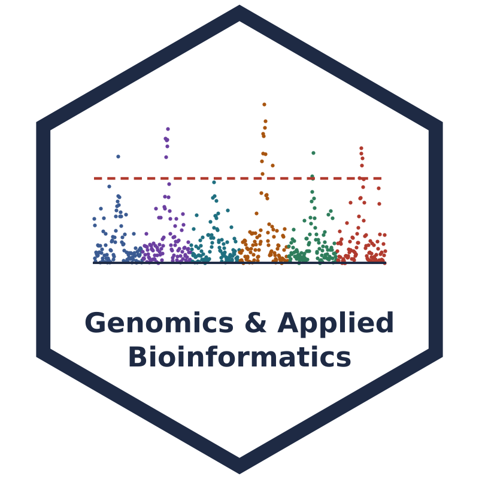

# Genomics & Applied Bioinformatics — companion book

The companion book for the Georgia Tech course **Genomics & Applied Bioinformatics**.
Each chapter pairs two lectures with short modules, self-check quizzes and a hands-on lab notebook
(Python, R, PLINK, BWA).

**Read the book:** https://ikingjordan3.github.io/gab-book/

## Layout

```
book/
  _config.yml, _toc.yml        book settings and table of contents
  intro.md, setup.md           front matter
  <chapter>/
    index.md                   chapter overview and module list
    <module>.md                one page per module, ending in a self-check quiz
    quizzes/<module>.json      quiz questions (jupyterquiz format)
    lab-<topic>.ipynb          lab notebook (not executed during the build)
  images/                      logo and favicon
tools/                         scripts that draw the logo and favicon
environment.yml                conda environment for the labs (Binder, course server, local)
requirements.txt               packages for building the book
```

## Build locally

```bash
pip install -r requirements.txt
jupyter-book build book
open book/_build/html/index.html
```

Pushing to `main` rebuilds the site with GitHub Actions and publishes it to GitHub Pages.

## License

Text, figures and quizzes: [CC BY 4.0](LICENSE-CONTENT.md). Code: [MIT](LICENSE).
